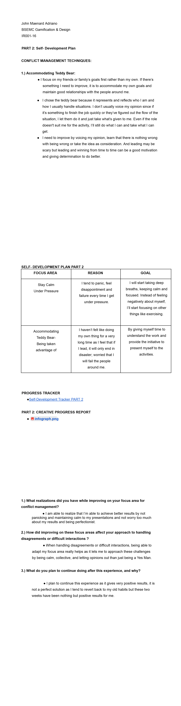

# John Maenard Adriano's Portfolio

#### Introduction
Hi! My name is John Maenard Adriano. I am studying Gamification & Design at CIIT college to which I plan to create and design worlds with video games, telling stories and showcasing original character ideas. When I started this course, I believe to the words; Life is like a Video Game. It is very simple yet if you see it as an RPG or source managing or even world building type game, the meaning becomes more and more deeper. I see my world as a Gacha game, everything is by luck. Earn your currency in order to buy what you wanted, can be perfect or defective; Everything is by luck in my world. For me, I'm not really much interested to the technology behind the game, I'm more interested to the design and how it was made, something where players or viewers think whether if the colors or mechanics of the game was intentional or not.

## About Me
I chose the program Gamification & Design but specialize more to the Design aspect of my course. I'm not much of a tech wizard person but experiencing and seeing people's works is my best learning style as I learned this technique through my own art experience; from copying until perfection and with the help from my school I'll be able to accomplish my goals faster. Currently the skills I'm trying to develop is my time management and software skills. Lastly my career interest is to be a world builder or game designer for a video game.

## My Learning Journey & Works
**Self Developments**
[Self-Development 1](assets/img/John_Maenard_Adriano_Self_Development_Plan_1.pdf)
This are my method regarding to managing my time and stress to develop self control whenever something overwhelms me or if my mentality is getting worse. 

**Self Development 2**
[Self-Development 2](assets/img/John_Maenard_Adriano_Self_Development_Plan_2.pdf)
This methods are my ways when experiencing conflict towards work mates or collaboration with other party. 

## Contacts
### Social Links
[Links](https://linktr.ee/mythiosdesu)

### Decoding Physical and Cognitive Impacts of Particulate Matter Concentrations at Ultra-Fine Scales
[Publication](https://www.mdpi.com/1424-8220/22/11/4240)

Used **Matlab** to train over 100 machine learning models which estimated particulate matter concentrations based on a suite of over 300 biometric variables. We found biometric variables can be used to accurately estimate particulate matter concentrations at ultra-fine spatial scales with high fidelity (r2 = 0.91) and that smaller particles are better estimated than larger ones. Inferring environmental conditions solely from biometric measurements allows us to disentangle key interactions between the environment and the body.

## Talks & Lectures
- Causality: The new science of an old question - GSP Seminar, Fall 2021
- Guest Lecture: Dimensionality Reduction - Big Data and Machine Learning for Scientific Discovery (PHYS 5336), Spring 2021
- Guest Lecture: Fourier and Wavelet Transforms - Scientific Computing (PHYS 5315), Fall 2020
- A Brief Introduction to Optimization - GSP Seminar, Fall 2019
- Weeks of Welcome Poster Competition - UTD, Fall 2019
- A Brief Introduction to Networks - GSP Seminar, Spring 2019

- [Data Science YouTube](https://www.youtube.com/channel/UCa9gErQ9AE5jT2DZLjXBIdA)
