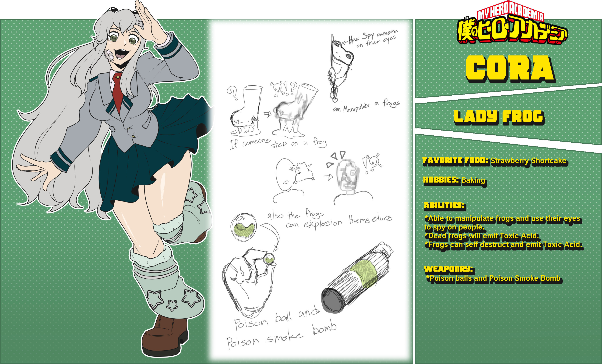
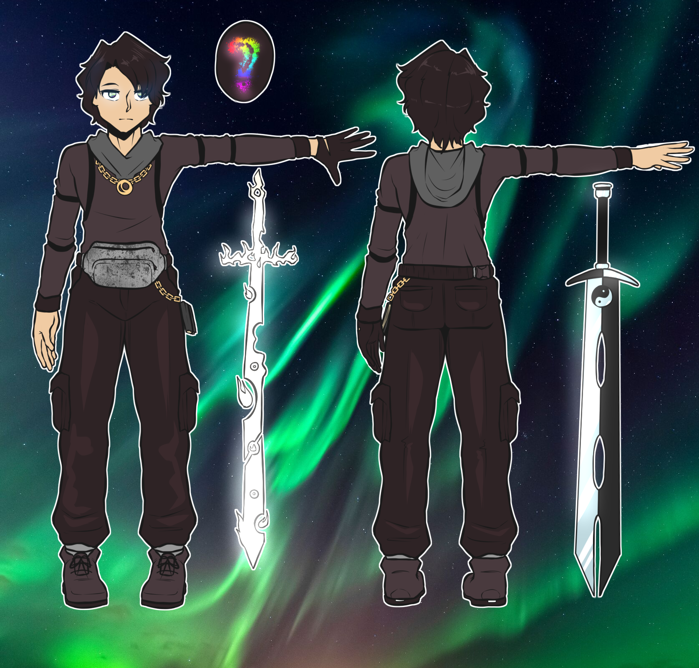
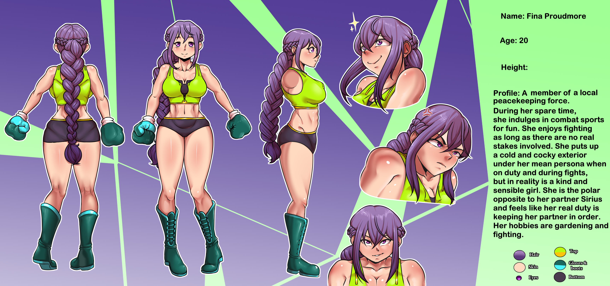

# John Maenard Adriano's Portfolio

#### Introduction
Hi! My name is John Maenard Adriano. I am studying Gamification & Design at CIIT college to which I plan to create and design worlds with video games, telling stories and showcasing original character ideas. When I started this course, I believe to the words; Life is like a Video Game. It is very simple yet if you see it as an RPG or source managing or even world building type game, the meaning becomes more and more deeper. I see my world as a Gacha game, everything is by luck. Earn your currency in order to buy what you wanted, can be perfect or defective; Everything is by luck in my world. For me, I'm not really much interested to the technology behind the game, I'm more interested to the design and how it was made, something where players or viewers think whether if the colors or mechanics of the game was intentional or not.

## About Me
I chose the program Gamification & Design but specialize more to the Design aspect of my course. I'm not much of a tech wizard person but experiencing and seeing people's works is my best learning style as I learned this technique through my own art experience; from copying until perfection and with the help from my school I'll be able to accomplish my goals faster. Currently the skills I'm trying to develop is my time management and software skills. Lastly my career interest is to be a world builder or game designer for a video game.

## My Learning Journey & Works
**Self Developments Works**
[Self-Development 1](assets/img/John_Maenard_Adriano_Self_Development_Plan_1.pdf)
This are my method regarding to managing my time and stress to develop self control whenever something overwhelms me or if my mentality is getting worse. Optimizing my productivity and maintain my responsibility by handling my deadlines better and a more healthy sleep schedule.

[Self-Development 2](assets/img/John_Maenard_Adriano_Self_Development_Plan_2.pdf)
This methods are my ways when experiencing conflict towards work mates or collaboration with other party. Handling disagreements or interactions by being calm, collective, and letting opinions out than just being a "Yes" man. Able to achieve results by not panicking, maintaining calm to my presentations and not worry to much about my results or being a perfectionist.

## Contacts
### Social Links
[Links](https://linktr.ee/mythiosdesu)

**My Tech Learning & Projects**

### Character Designs
CORA NARA

MIST ALTERNATE

YALIA

### Game Concept

Game Idea is a Pixelated, Puzzle, Side scroller, Platformer, 4-Player, RPG game.. 4 Heroes co-op game, can play solo or add bots to play with Description: You can play the game Solo or with Friends. Game is with lots of platforms and a bit of puzzles. Heroes to choose are based on the difficulty; Paladin for Easy, Knight for Normal, Mage for Hard and Berserker for Insane. Controls: The game will have Jump, Dodge, Attack and Ability buttons. Hud: The Hud will be at top with the Characters profiles, Health for each character, Mana Meter for the characters Special Abilities, and Mana box to fill in items for Characters passive. Heroes consist of; Paladin- has the most health and most Mana. His ability is he can heal himself and specific character in need. His healing ability can also be used as projectile when allies are far away. Knight- has less than to the Paladin and half the mana. His ability is to throw thunderbolts at enemies and boosting his allies with Buffs randomly;

## Talks & Lectures
- Causality: The new science of an old question - GSP Seminar, Fall 2021
- Guest Lecture: Dimensionality Reduction - Big Data and Machine Learning for Scientific Discovery (PHYS 5336), Spring 2021
- Guest Lecture: Fourier and Wavelet Transforms - Scientific Computing (PHYS 5315), Fall 2020
- A Brief Introduction to Optimization - GSP Seminar, Fall 2019
- Weeks of Welcome Poster Competition - UTD, Fall 2019
- A Brief Introduction to Networks - GSP Seminar, Spring 2019

- [Data Science YouTube](https://www.youtube.com/channel/UCa9gErQ9AE5jT2DZLjXBIdA)
